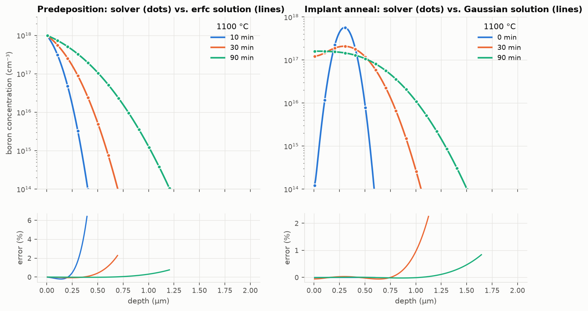
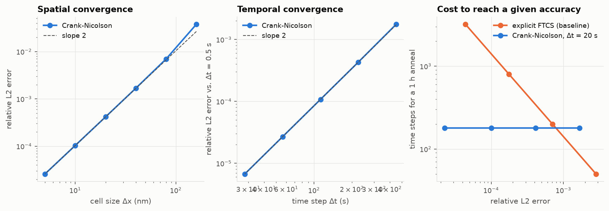
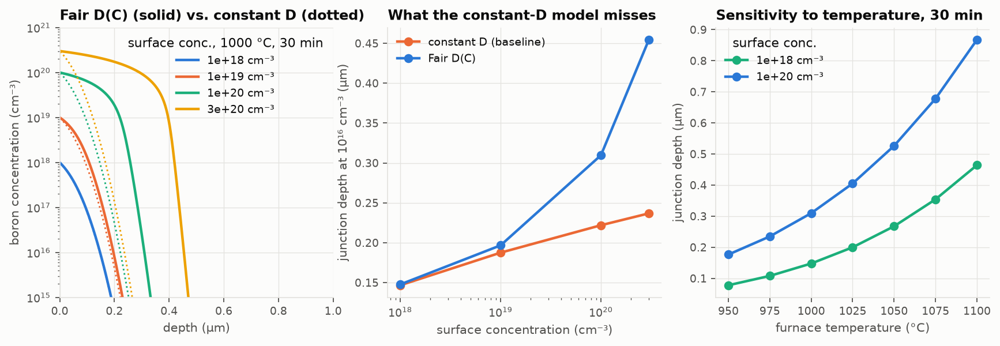
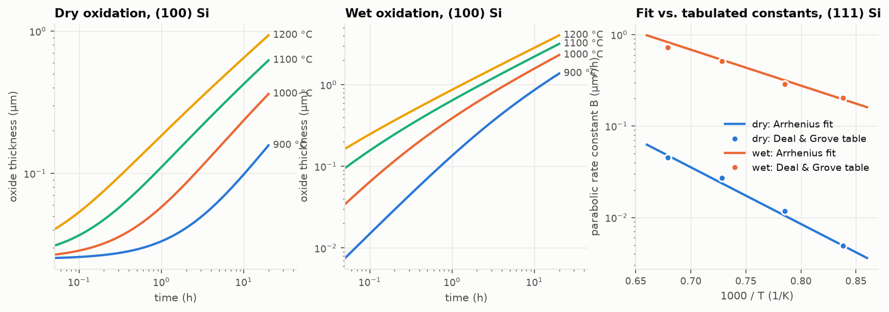

# thermal-process-sim

[](https://github.com/Soham-Padalkar/thermal-process-sim/actions/workflows/ci.yml)

1-D models of two thermal steps in silicon fabrication — **oxide growth** (Deal–Grove) and **dopant diffusion** (finite-volume solver with concentration-dependent diffusivity) — each checked against closed-form solutions and published constants.



*Numerical profiles (dots) against the erfc and Gaussian closed-form solutions (lines) for boron at 1100 °C, with the point-wise error below.*

## Problem

Junction depth and oxide thickness set the electrical behaviour of a device, and both come out of furnace steps that cannot be observed while they run. Process engineers therefore predict them. The textbook formulas (erfc and Gaussian profiles) assume a constant diffusivity, which stops being true once the doping exceeds the intrinsic carrier density at the furnace temperature (about 7 × 10¹⁸ cm⁻³ at 1000 °C). This project asks two questions:

1. Can a small solver reproduce the closed-form results to a known accuracy?
2. Once it does, how wrong is the constant-diffusivity assumption at high doping?

## Method and why

| Piece | Choice | Reason |
|---|---|---|
| Oxidation | Deal–Grove linear-parabolic model, closed form plus an independent RK4 integration | The closed form is exact for the model; the integrator cross-checks it and is the starting point for temperature ramps |
| Diffusion, baseline | Explicit forward-time centred-space (FTCS) | Simplest correct scheme; gives a reference for cost |
| Diffusion, main solver | Crank–Nicolson on a finite-volume grid, tridiagonal solve | Second order in space and time and unconditionally stable, so the time step is set by accuracy rather than by Δx² |
| High doping | Fair's charged-vacancy model, D = D⁰ + D¹·(n/nᵢ) (+ D²·(n/nᵢ)²) | Standard first correction to constant D; has no closed-form solution, so it needs the solver |

The finite-volume form conserves dose to round-off with zero-flux boundaries, which gives a strong built-in check.

## Layout

```
src/fabsim/
  oxidation.py   Deal-Grove rate constants, closed form, RK4 integration
  diffusion.py   grid, FTCS and Crank-Nicolson solvers, analytical profiles, Fair D(C)
  reference.py   Deal & Grove (1965) tabulated constants used for comparison
  figures.py     regenerates every figure and docs/figures/results.json
tests/           25 tests: analytical agreement, conservation, convergence order, stability
```

## Setup

```bash
python -m venv .venv && source .venv/bin/activate   # Windows: .venv\Scripts\activate
pip install -r requirements.txt && pip install -e .
pytest                      # ~1 s
python -m fabsim.figures    # rewrites docs/figures/ (~5 s, deterministic)
```

Minimal use:

```python
import numpy as np
from fabsim.oxidation import rate_constants, oxide_thickness
from fabsim.diffusion import Grid, crank_nicolson, fair_diffusivity, junction_depth

print(oxide_thickness(2.0, rate_constants(1000, "wet")))  # um after 2 h of wet oxidation
grid = Grid(length=2e-4, n=500)  # 2 um, 4 nm cells
c = crank_nicolson(np.zeros(grid.n), grid, fair_diffusivity("boron", 1000), 1800, dt=2.0, surface=1e20)
print(junction_depth(c, grid, background=1e16) * 1e4, "um")
```

## Results

All numbers below are produced by `python -m fabsim.figures` and stored in `docs/figures/results.json`.

**Validation against closed-form solutions.** Point-wise error stays below 6.5 % over four decades of concentration below the peak; it is largest in the far tail, where the profile is steepest relative to the 10 nm cell.

**Convergence.** Measured order of accuracy is 2.08 in space and 2.01 in time (expected: 2).



**Baseline vs. implicit solver.** For a 1 h anneal on an 800-cell grid, FTCS needs 3200 steps (stability limit) where Crank–Nicolson uses 180 and is slightly more accurate (relative L2 error 2.3 × 10⁻⁵ vs. 4.4 × 10⁻⁵). On a 100-cell grid FTCS is cheaper; the implicit solver pays off as the grid is refined.

**What constant D misses.** For a 30 min boron predeposition at 1000 °C:

| Surface concentration (cm⁻³) | Junction depth, constant D (µm) | Junction depth, Fair D(C) (µm) |
|---|---|---|
| 1 × 10¹⁸ | 0.147 | 0.148 |
| 1 × 10¹⁹ | 0.187 | 0.197 |
| 1 × 10²⁰ | 0.222 | 0.310 |
| 3 × 10²⁰ | 0.237 | 0.454 |

The two agree at low doping (a test enforces this) and differ by 1.9× at 3 × 10²⁰ cm⁻³, with the box-like profile shape expected of concentration-enhanced diffusion.



**Sensitivity.** Junction depth changes by 1.1–1.2 % per °C around 1000 °C, so a ±5 °C furnace error moves the junction by about ±6 %.

**Oxidation.** The Arrhenius fits used here track the rate constants tabulated by Deal and Grove (1965) to within 15 % for B and 20 % for B/A over 920–1200 °C.



## Limitations

- **No experimental data.** Everything is compared with analytical solutions or published constants; nothing here was measured (no SIMS profiles, no ellipsometry).
- The Deal–Grove table in `reference.py` was transcribed from textbook reproductions of the 1965 paper, not from the paper itself. Check it against the original before citing.
- Fair-model parameters are textbook values. The model ignores electric-field enhancement, clustering/solid-solubility limits, and oxidation-enhanced diffusion, so high-concentration results are qualitative.
- Deal–Grove underpredicts thin dry oxides (below about 25 nm); the usual initial-oxide offset is supported but the thin regime itself is not modelled.
- 1-D only: no lateral diffusion under mask edges, no moving Si/SiO₂ boundary, no dopant segregation into the oxide.
- With concentration-dependent D the solver lags D by one step, which reduces time accuracy to first order for that case.

## Next steps

- Compare against a published SIMS profile (the missing experimental check).
- Couple the two models: moving oxide boundary with segregation during drive-in.
- Predictor–corrector treatment of D(C) to restore second-order time accuracy.
- Electric-field term for high-concentration arsenic and phosphorus.

## References

- B. E. Deal and A. S. Grove, "General relationship for the thermal oxidation of silicon," *J. Appl. Phys.* 36, 3770 (1965).
- R. B. Fair, "Concentration profiles of diffused dopants in silicon," in *Impurity Doping Processes in Silicon* (1981).
- J. D. Plummer, M. D. Deal, P. B. Griffin, *Silicon VLSI Technology* (2000), chs. 6–7.

MIT licensed.
